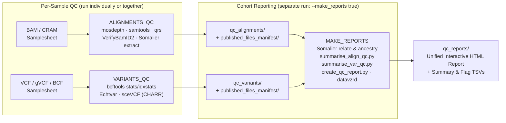

# nf-WGS-QC

**nf-WGS-QC** is a modular Nextflow pipeline (`>= 26.04`) developed by the Human Technopole Genome Analysis Unit for scalable Whole Genome Sequencing (WGS) quality control. It covers per-sample alignment QC, per-sample variant QC, and cohort-level aggregation with interactive HTML reporting.

## Architecture

The pipeline is organized into three workflows orchestrated by `main.nf`:

## Key Capabilities

- **Decoupled per-sample and cohort stages**: Run alignment and variant QC incrementally as sequencing batches arrive, then aggregate any number of QC output folders into a single cohort report.
- **Comprehensive alignment metrics**: Global/regional/threshold/quantized coverage (`mosdepth`), mapping and base-quality stats (`samtools stats`/`idxstats`), per-flowcell/lane read metrics (`qrs`), contamination (`VerifyBamID2`), and genetic fingerprinting (`Somalier`).
- **Comprehensive variant metrics**: Filtered whole-genome and region-specific `bcftools stats` & `idxstats`, plus variant-level contamination via CHARR (`sceVCF`) with optional `Echtvar` allele frequency annotation.
- **Automated PASS / WARN / FAIL classification**: Configurable YAML rule sets evaluate alignment and variant metrics independently and jointly across the cohort.
- **Interactive HTML report**: Unified `datavzrd` report linking project summaries, flag distribution bar plots, QC criteria, and per-sample alignment/variant metric tables by sample ID.
- **Strict schema validation**: All pipeline parameters and input samplesheets are validated upfront via `nf-schema`.

## Requirements

- [Nextflow](https://www.nextflow.io/) `>= 26.04`
- Container runtime: **Singularity**, **Apptainer**, or **Docker** (note: `QUICK_READS_STATS` and `COMPUTE_CHARR` require containers and do not support Conda/Mamba).

## Next Steps

- Prepare your input samplesheets and reference files in [Inputs & Samplesheets](usage/inputs.md).
- See execution examples and profiles in [Running the Pipeline](usage/running.md).
- Customize cohort QC thresholds in [QC Criteria & Flags](reference/qc_criteria.md).
